# DisplayHelp

[-2ea44f)](https://github.com/hov172/DisplayHelp/releases/latest)
[](#install)
[](#install)
[-ff0000?logo=youtube&logoColor=white)](https://youtu.be/JUq-EWzM_t8)

**DisplayHelp is a menu bar app for macOS that makes projectors, TVs and external displays behave.** Plug in, answer one question, and it remembers the room. Built by Ayala Solutions for school helpdesks and for anyone who connects a Mac to a different screen every day.

<p align="center">
  <a href="docs/images/menu-viewport.png">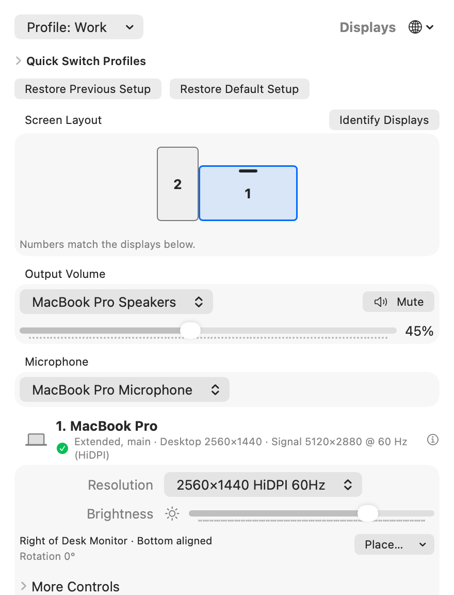</a>
</p>

- **One menu bar icon.** No main window, no account. Settings stay on your Mac; profile sharing is your choice.
- **Remembers every room.** Named profiles capture every connected display and load when that set connects.
- **Fixes the usual trouble.** Wrong size after plug-in, a cut-off Dock, snow on a TV, a projector that cannot take 4K.
- **Installs cleanly.** Signed and notarized installer, starts at login, updates itself and can uninstall itself.

Feedback, bug reports and suggestions are welcome.

### Downloads

Latest release **0.8.1 (155)** · macOS 14 Sonoma or later · Apple Silicon and Intel · Proprietary, not open source · [What's new](CHANGELOG.md)

| Asset | Download |
|---|---|
| Signed and notarized installer | [DisplayHelp-0.8.1.pkg](https://github.com/hov172/DisplayHelp/releases/download/v0.8.1/DisplayHelp-0.8.1.pkg) |
| Video guide (38 min, chaptered) | [Watch on YouTube](https://youtu.be/JUq-EWzM_t8) |
| User guide | [PDF](https://github.com/hov172/DisplayHelp/releases/download/v0.8.1/DisplayHelp-0.8.1-User-Guide.pdf) · [Word](https://github.com/hov172/DisplayHelp/releases/download/v0.8.1/DisplayHelp-0.8.1-User-Guide.docx) |
| Custom Fixes examples and installation README | [DisplayHelp-0.8.1-Custom-Fixes.zip](https://github.com/hov172/DisplayHelp/releases/download/v0.8.1/DisplayHelp-0.8.1-Custom-Fixes.zip) |
| Current UI screenshots | [DisplayHelp-0.8.1-Screenshots.zip](https://github.com/hov172/DisplayHelp/releases/download/v0.8.1/DisplayHelp-0.8.1-Screenshots.zip) |
| MDM profile that pre-approves the updater | [DisplayHelp-BackgroundItems.mobileconfig](https://github.com/hov172/DisplayHelp/releases/download/v0.8.1/DisplayHelp-BackgroundItems.mobileconfig) |
| SHA-256 checksums | [SHA256SUMS.txt](https://github.com/hov172/DisplayHelp/releases/download/v0.8.1/SHA256SUMS.txt) |

Homebrew users can `brew install --cask displayhelp` from the `hov172/displayhelp` tap; see [Install](#install).

<sub>Screenshots use sample display data rendered by the production views; the screen diagram shows geometry, not desktop content. Menu captures show 0.6.8 (124); 0.6.9 added a Check for Update… button beside Quit in the footer, and 0.6.10 adds Install to its dialog. Other captures are from 0.6.6 and show controls unchanged in 0.8.1. [Screenshot details](docs/README.md#screenshots).</sub>

## Contents

**Get started**
- [Why it exists](#why-it-exists)
- [Install](#install) · [Check your installed version](#check-your-installed-version)
- [Updating](#updating)
- [First plug-in](#first-plug-in)
- [Languages and how to switch](#languages-and-how-to-switch)

**Use it every day**
- [The menu at a glance](#the-menu-at-a-glance)
- [Everyday use](#everyday-use)
  - [Signal Cap: keep a projector or long cable off 4K](#signal-cap-keep-a-projector-or-long-cable-off-4k)
- [Output Volume and Microphone](#output-volume-and-microphone)
- [Identify your screens](#identify-your-screens)
- [Choose and save the main screen](#choose-and-save-the-main-screen)
- [Profiles: one name per room](#profiles-one-name-per-room)

**When something goes wrong**
- [When something still looks off](#when-something-still-looks-off)
- [Fixes](#fixes) · [Custom Fixes setup](#custom-fixes-install-and-use-your-own-actions)
- [Clear history, forget a display, or start fresh](#clear-history-forget-a-display-or-start-fresh)
- [Where it keeps things](#where-it-keeps-things)

**For helpdesks and IT**
- [Helpdesk deployment](#helpdesk-deployment)
- [Example custom scripts](#example-custom-scripts)
- [Privacy](#privacy)
- [Resources](#resources)

This README is the short version. The [user guide](docs/user-guide.md) covers every control, the [FAQ](docs/faq.md) gives short answers, and [troubleshooting](docs/troubleshooting.md) goes symptom by symptom.

## Why it exists

Every teacher has lived this. The projector shows a stretched picture. The Dock is half off the screen. The text is tiny. The laptop shows a black band. The TV shows snow. macOS can fix all of it if you know which of four panes to open, but the person at the front of the room has thirty seconds and a class waiting.

DisplayHelp puts the handful of things that actually fix these problems in one menu, applies them automatically once it has seen a display, and keeps a log so the helpdesk can see what happened when someone calls. It was built against real hardware, and every default in it came from a problem that showed up on a real TV or projector.

| Problem | What DisplayHelp does |
|---|---|
| Wrong resolution after plugging in | Remembers the right one per display and re-applies it on every reconnect |
| Dock half cut off | Restarts the Dock after the display settles |
| Snow on a TV | Filters sizes using the display’s supported-size information when available |
| Tiny UI on a 4K TV | Prefers readable HiDPI scaling when a suitable mode is available |
| Laptop and TV on different sizes | Keeps a mirror set on one logical size in both directions |
| Different rooms, different needs | Named profiles that capture every connected display |
| "It just keeps coming up wrong" | One-click reset of macOS's display database |

## Install

- Get the latest signed and notarized DisplayHelp installer from Ayala Solutions or your organization’s helpdesk. Open it and follow the installation prompts. The app installs in Applications and starts automatically.

- Look for the display icon in the menu bar. That is the whole app.

- Later updates install from **Check for Update…** in the menu; an administrator approves "DisplayHelp Updater" once in Login Items & Extensions, and after that standard users can click Install themselves.

- It starts at login for everyone who uses the Mac, so it is there tomorrow. To stop that for your account, turn DisplayHelp off in System Settings › General › Login Items › Allow in the Background.

- With Homebrew, from a terminal:

  ```sh
  brew tap hov172/displayhelp
  brew trust hov172/displayhelp
  brew install --cask displayhelp
  ```

  > [!NOTE]
  > Homebrew 5 and later refuse third-party taps until you trust them once; that is what `brew trust` does.

  This runs the same signed installer package. Later, `brew upgrade --cask displayhelp` updates it and `brew uninstall --cask displayhelp` removes it with the login agent.

- With AutoPkg (Munki, Jamf Pro, Intune), recipes live in [hov172/autopkg-recipes](https://github.com/hov172/autopkg-recipes):

  ```bash
  autopkg repo-add hov172/autopkg-recipes
  autopkg run -v DisplayHelp.munki   # or DisplayHelp.jamf / DisplayHelp.intune
  ```

  They pull the same signed, notarized package from this repository's releases, verify its Developer ID signature, and import or upload it with the app icon. Deploy the configuration profile below alongside it.

For organization-wide installation, ask your IT team to deploy the installer through its Mac management service and test it in representative rooms first. See [rollout](docs/rollout.md). An MDM can also pre-approve the DisplayHelp Updater helper with the [included configuration profile](mdm/DisplayHelp-BackgroundItems.mobileconfig), so standard users install updates without an administrator.

### Check your installed version

<p align="center">
  <a href="docs/images/about.png">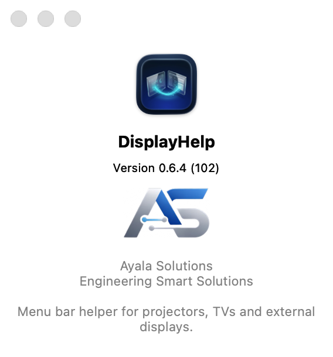</a>
</p>

Open the DisplayHelp menu and click **Ayala Solutions · ‹version›** at the bottom right. Include the version shown in About with any support request. Shown: the 0.6.6 About panel; 0.8.1 reads 0.8.1 (155).

## Updating

- **In the app:** click **Check for Update…** beside Quit. **Install** updates in place with no password once an administrator has approved **DisplayHelp Updater** one time per Mac, or an MDM has pushed the included profile. **Download** fetches the installer package for a manual install.
- **Homebrew:** `brew upgrade --cask displayhelp`.
- **Managed Macs:** IT pushes the package through the MDM, optionally with the [profile](mdm/DisplayHelp-BackgroundItems.mobileconfig) that pre-approves the helper fleet-wide.

Every path installs the same signed package and keeps your profiles and settings. The [user guide](docs/user-guide.md#updating-displayhelp) covers each option step by step.

## First plug-in

The first time a display is connected, a small dialog asks one question:

<p align="center">
  <a href="docs/images/first-connect.png">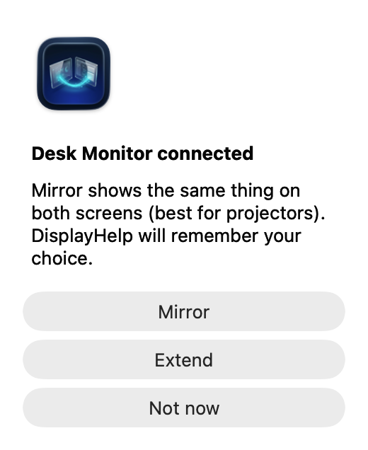</a>
</p>

- **Mirror** for teaching. Both screens show the same thing.
- **Extend** for working. The other screen becomes a second desktop.
- **Not now** leaves macOS's default and asks again next time.

Mirror or Extend is remembered for this display on this Mac. Settings do not sync between Macs; use profile export and import to transfer a setup. See [the connect dialog](docs/user-guide.md#the-connect-dialog).

## Languages and how to switch

DisplayHelp is available in eleven languages:

| Language | Name shown in the globe menu |
|---|---|
| English | English |
| German | Deutsch |
| Spanish | Español |
| French | Français |
| Italian | Italiano |
| Japanese | 日本語 |
| Korean | 한국어 |
| Brazilian Portuguese | Português (Brasil) |
| Simplified Chinese | 简体中文 |
| Traditional Chinese | 繁體中文 |
| Arabic | العربية |

<p align="center">
  <a href="docs/images/language-menu.png">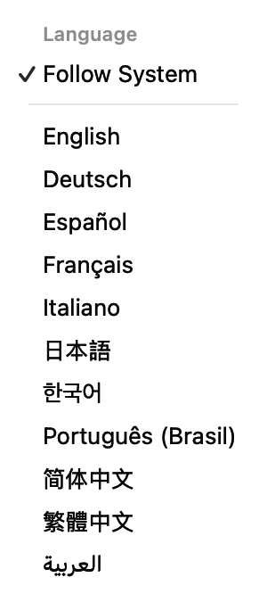</a>
</p>

DisplayHelp follows your Mac's language preferences by default. To use a different language in DisplayHelp only, click the **globe** at the top of the menu, choose a language by its native name, then **Restart Now**. Choose **Follow System** to return to the Mac's preferences. Both routes use Apple's native per-app language preference and the same bundled translations; no online translation service is used, and macOS does not generate missing translations. Language is separate from display profiles.

Translations are machine-assisted and checked against Apple terminology; corrections are welcome via [GitHub issues](https://github.com/hov172/DisplayHelp/issues).

Full details, including the System Settings routes: [user guide › Language](docs/user-guide.md#language).

## The menu at a glance

Click the icon. Top to bottom:

| Row | What it is |
|---|---|
| Profile, Displays heading, globe | Save, preview, restore, update, remove, import and export named setups; the globe at the right end chooses an app language or Follow System (restart to apply). |
| Quick Switch Profiles | Favorite 1 (⌘⌥1) and Favorite 2 (⌘⌥2) slots, Save Current Setup as Default, and the Restore Previous Setup / Restore Default Setup buttons. |
| Screen Layout | Numbered geometry preview with Identify Displays in its header. |
| Output Volume | The Mac's default output in a picker that switches it, like Sound › Output, with live volume and mute when the device supports them. |
| Microphone | The Mac's default input in a picker that switches it, like Sound › Input. Remembers nothing; the per-display Mic row is what follows a display. |
| Display cards | Common controls, the HDCP state at the end of the status line, plus observed placement, alignment and rotation beside Place…. Expand More Controls for refresh rate, recommendations, audio, mic, rotation, Signal Cap, Check HDCP and the rest. |
| Troubleshooting | Detect Displays (applies recommendations), fixes, Recent Events with Show History File, and Copy Diagnostics. Reset All DisplayHelp Data and Uninstall are under More. |
| Quit DisplayHelp, Check for Update…, Ayala Solutions · version | Footer; Check for Update… contacts GitHub only when clicked; the version button opens About. |

<p align="center">
  <a href="docs/images/menu.png">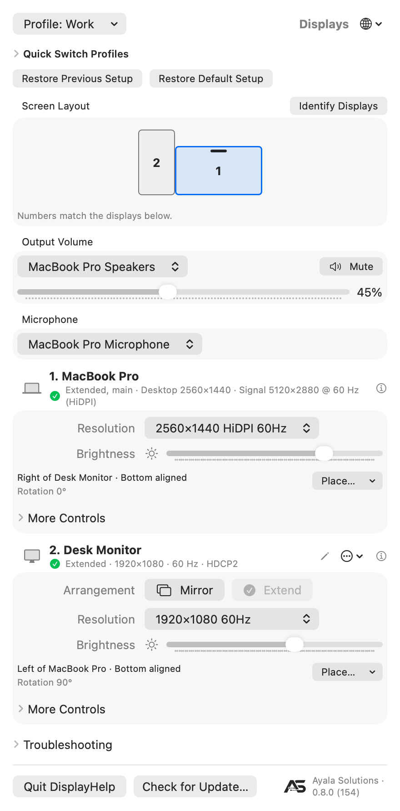</a>
</p>

The menu bar icon itself shows state: stacked rectangles when mirrored, two displays when extended, one when a single display is connected. The idle one-screen icon is the plain glyph; every colored state is a stroked outline. Green once a second screen is connected. Orange when something waits on you: a Keep/Revert countdown, a pending profile restore, profiles that could not load, or an EDID Cap not yet in effect (not applied, written and awaiting reconnect, removal awaiting reconnect, or another EDID override in place). Red for any error shown under the cards (a failed display change or revert, a failed microphone selection, an unavailable saved mode) or a Signal Cap that leaves a display with no usable mode. Red wins over orange, and both are drawn even with a single screen.

<p align="center">
  <a href="docs/images/menu-bar-icon.png"></a>
</p>

Each card’s status line starts with an icon. A green check means the display is on a mode the app would choose. A grey ⓘ means a different mode is recommended or the external display is running below 50 Hz; when a faster rate exists at the same size, an orange one-click hint appears under the line. On a HiDPI mode the line names both sizes, `Desktop 1920×1080 · Signal 3840×2160 @ 60 Hz (HiDPI)`; a plain mode shows its size alone. The status line ends with the HDCP state macOS reports; **Check HDCP** under More Controls reads it again. DisplayHelp only reads HDCP state; it never changes or negotiates protection.

Every row is described in the [user guide](docs/user-guide.md#display-cards).

## Everyday use

<p align="center">
  <a href="docs/images/more-controls.png">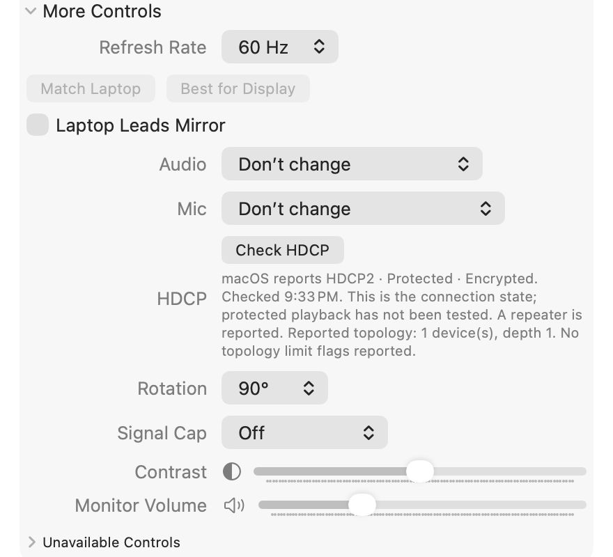</a>
</p>

- **"The picture is wrong, fix it":** open **Troubleshooting → Detect Displays** to rescan and apply the app’s recommendations for resolution, refresh rate and which display leads mirroring.
- **Mirror or Extend:** two buttons on each external display's card. The one you are on is greyed. The choice is remembered.
- **Place…:** appears beside the current placement and rotation when displays are extended; put a display left, right, above or below another with edge or center alignment. **Make Main** is inside that menu.
- **Resolution:** lists available sizes and scaling options, filtered by the display's supported-size information when available. On external displays the plain size comes before the HiDPI entry of the same size, and a Signal Cap hides sizes above it. **Refresh Rate** is under **More Controls** when the current size offers more than one rate.
- **Match Laptop / Best for Display:** under **More Controls** on an external card; one-click recommendations that prefer readable HiDPI modes and 50 Hz or better.
- **Laptop Leads Mirror:** off by default, so the TV's shape wins. On, the laptop is full-screen and the TV shows side bars.
- **Audio:** under **More Controls**; which output plays the Mac's sound whenever this display is connected. "Don't change" is the default, so plugging in to charge never hijacks a call.
- **Mic:** under **More Controls** on an external card; which microphone becomes the Mac's default input whenever this display is connected, applied on connect and again when the mic itself shows up later. "Don't change" is the default. Full-setup profiles carry it.
- **Rotation, Underscan, Brightness, Contrast, Monitor Volume:** appear only when the display, connection and available readings support them.
- **Rename:** the pencil next to an external display’s name stores a room name for this user on this Mac.
- **ⓘ:** the information popover shows the current mode, native size and supported resolutions for support requests.

### Signal Cap: keep a projector or long cable off 4K

When the selected mode is HiDPI, the status line adds `Desktop 1920×1080 · Signal 3840×2160 @ 60 Hz (HiDPI)`; a plain mode shows its size alone. "Desktop" is the size of your workspace. "Signal" is the size macOS renders and sends down the cable. A HiDPI size such as 1080p HiDPI on a 4K display still sends 4K, which is what a long cable or an older projector cannot carry. The Resolution picker lists the plain size before the HiDPI one.

**Signal Cap** (More Controls, external displays only, Intel and Apple Silicon) sets a ceiling: **Off, 4K at 30 Hz, 1440p, 1080p, 720p**. It limits the size and the pixel rate: 4K at 30 Hz allows up to 3840×2160 at 30 Hz, the other levels their size at 60 Hz, so a 1080p cap drops 1080p at 120 Hz and keeps 720p at 120 Hz. Larger sizes disappear from the Resolution picker ("Sizes above 1080p are hidden by Signal Cap."), Best for Display, Match Laptop, Detect Displays and the refresh picker follow the cap, and saved profiles that ask for more are lowered (the profile file is not changed; Recent Events says so). The cap also lowers the display on connect and whenever something else raises it. Setting, changing or clearing the cap uses Keep/Revert; Revert restores the previous cap and mode. If no mode fits, nothing changes and the card says "No mode under cap available" in orange.

**Enforce at EDID level (advanced)** appears under the cap once one is set (on Intel it needs the self-service updates approval first; see below). It goes one step further: it hands macOS a trimmed copy of the display's own EDID, through a private macOS interface, so sizes above the cap stop existing as far as macOS knows. It only ever removes timings (when a display lists its sizes under the cap only as video codes or standard timings, the first detailed timing is rebuilt from one of those, using the CTA-861, VESA DMT or the display's declared CVT/GTF formula, never from anything the display did not claim); a validator refuses anything that would add a size, raise a clock or change the display's identity. Turning it on asks "Change what macOS sees?", the display flickers and reconnects, and the change runs under Keep/Revert. DisplayHelp then puts back the remembered arrangement and modes of every display, because macOS otherwise treats the renegotiated display as new and mirrors it as the main display. Turning it off renegotiates and restores the arrangement the same way. While it is on, the card reads "EDID Cap: active" and "macOS now treats this display as 1920×1080 @ 60 Hz at most. The fingerprint of the EDID in use is in Copy Diagnostics." The other states are "EDID Cap: not applied (see Recent Events)", "EDID Cap: paused (display changed)", "EDID Cap: not supported on this macOS" and "Another EDID override is active". Nothing survives a restart; the app re-applies it on connect and wake, and pauses ("EDID Cap: paused (display changed)") if it sees a different unit or firmware. Changing or clearing the Signal Cap turns the EDID Cap off. If DisplayHelp quits unexpectedly during the 20-second trial, it recognizes the leftover override at the next launch by a fingerprint saved before the apply (even when macOS reports the trimmed copy as the display's EDID) and gives the display its own EDID back; a kept cap for another level is then re-applied. Unplugging and replugging or sleeping the Mac also clears it. **Forget This Display** and **Reset All DisplayHelp Data** give the display its own EDID back first, and refuse if that fails.

**On Intel Macs** the same toggle writes a model-wide override file (`/Library/Displays/Contents/Resources/Overrides`) through DisplayHelp Updater, so it needs the one-time self-service updates approval first (until then the toggle says "Set up self-service updates first"). It applies to every unit of that model on the Mac, takes effect only after the display reconnects or the Mac restarts ("EDID Cap: written, takes effect after reconnect or restart"), and survives restarts. There is no Keep/Revert and no 20-second auto-revert: to undo, turn it off and reconnect the display ("EDID Cap: removed, …"). Uninstall and Reset All DisplayHelp Data remove the file. macOS 26 is the last release for Intel Macs.

Order for a room: pick a plain size (no "(HiDPI)" in the status line), then Signal Cap, then the EDID toggle if the projector still reports 4K input.

**Picking 1080p, Signal Cap, or EDID level: which one?** They do different amounts of work, and the difference is what macOS still believes about the display.

- **Picking 1920×1080 60 Hz in Resolution** is a one-time choice. macOS still knows the display is 4K and keeps every larger size available, so Detect Displays, Best for Display, a profile saved at 4K, System Settings, another app or a reconnect can put it back. On Apple Silicon a plain 1080p pick sometimes does not change the wire signal at all: the desktop is 1080p, the link stays at the panel's native timing and macOS scales.
- **Signal Cap 1080p** is a standing rule the app enforces with public APIs: larger sizes hidden in its picker, recommendations kept under the ceiling, the mode lowered again on connect, after wake and whenever something raises it, and a saved profile mode substituted. macOS itself still believes the display is 4K, so the first seconds after plug-in and the login window negotiate at native, and a Mac that scales instead of switching timing can still send 4K.
- **Enforce at EDID level** changes what macOS believes. With the 4K timings gone from the EDID, macOS lists nothing above 1080p anywhere, System Settings included, and negotiates a 1080p link because it has no 4K timing to fall back on. The cost is a private interface, a flicker when it applies, and on Apple Silicon a re-apply after every restart.

> [!TIP]
> **Rule of thumb:** pick plain 1080p and read the projector's input menu. If it says 1080p and nobody touches the Mac, stop there. If it says 4K or the setting keeps drifting back, set the cap. If it still says 4K with the cap on, turn on the EDID level.

**With the cap Off, will the Mac still try higher speeds when Resolution is set to 1080p?** Mostly no, with real gaps. macOS does not change a mode on its own while the display stays connected, and DisplayHelp puts the remembered 1080p back when the display reconnects, so day to day the link runs at 1080p. It goes higher anyway at every plug-in and wake, because the link is negotiated from the display's EDID before any mode is set: the first seconds run at the display's advertised maximum, then macOS picks its own default (often 4K), and only then does DisplayHelp apply 1080p. On a cable that cannot carry 4K that is a black flash or a failed handshake each time, and the cap does not close that window either; only the EDID level does. It also goes higher whenever anything picks a mode: Best for Display, Detect Displays, a profile saved at 4K, System Settings, another display tool, or a presenter choosing the HiDPI 1080p entry. The cap refuses or lowers all of those; with it Off nothing does. And on Apple Silicon a plain 1080p mode can still go out as a 4K link while macOS scales the desktop, which neither the picker nor the cap changes. So: the picker sets the mode once, the cap keeps software from raising it, and the EDID level keeps macOS from negotiating above it at all, plug-in included.

**How the Intel path works, step by step.** On Intel, macOS checks a folder for an override file named after the display's vendor and product IDs when a display connects, and uses the EDID inside it instead of the display's own. DisplayHelp uses that documented mechanism (Apple Silicon ignores the folder, which is why the two platforms differ):

1. Ticking the toggle checks that the Mac is Intel and that DisplayHelp Updater is approved; the override folder is root-owned and the updater is the app's only root helper.
2. The app reads the display's own EDID, trims the timings above the cap with the same trimmer and validator as on Apple Silicon, and asks "Change what macOS sees for every [model] on this Mac?". The file is keyed by model, not serial, so every unit of that model on the Mac gets the cap.
3. The updater checks the caller's signature, re-runs the validator, builds the path from the numeric IDs itself, refuses symlinks and any file it did not write, and writes the plist atomically with a `DisplayHelpManaged` marker.
4. The card shows "EDID Cap: written, takes effect after reconnect or restart". Nothing changes on screen until the display reconnects or the Mac restarts; from then on macOS treats the display as capped from the moment it is detected, login window included, and this survives restarts without the app re-applying anything.
5. Turning it off deletes the file; the display keeps the trimmed EDID until the next reconnect or restart, so the card says "removed, takes effect after reconnect or restart". There is no 20-second auto-revert on Intel.

If someone else's file is already there, the app refuses with "Another EDID override is active" and the updater never overwrites or deletes a file it did not mark. A missing file is rewritten silently once per connection while the cap is on. Uninstall sweeps every marked file for all users; Reset All and Forget Display remove the ones this user tracks. The file's path is saved before the updater is asked to write it, so a crash before Keep or a lost reply never leaves a file they cannot find. After a self-service update the old updater exits once its work is done; until then the app says "Restart the Mac to finish updating DisplayHelp Updater" instead of hanging. macOS 26 is the last release for Intel Macs, so this serves macOS 14 to 26.

**How to cap a projector at 1080p**

1. On the projector's card, pick a plain size in **Resolution**, so the status line shows no "(HiDPI)".
2. Expand **More Controls** and set **Signal Cap** to **1080p**.
3. Check the picture, then choose **Keep Changes**. The projector's input-info menu should now report 1080p.

**How to turn on the EDID Cap** (Apple Silicon, only if the projector still reports a 4K input)

1. With a Signal Cap set, turn on **Enforce at EDID level (advanced)** under it.
2. Choose **Apply** in "Change what macOS sees?". The display flickers and reconnects; DisplayHelp puts the arrangement back.
3. Check every screen, then choose **Keep Changes**. The card reads "EDID Cap: active".

> [!NOTE]
> **Why two steps, with a Keep in between.** The toggle is visible as soon as a cap is set, but it stays greyed out, like every control on the card, until the cap's own Keep/Revert countdown is kept or reverted. Keep/Revert is a trial of exactly one change: Revert restores one recorded "before" state, and if two changes could stack during a countdown a failed revert could leave both applied on a screen you cannot read. Keeping the plain cap first also tells you which half broke the picture if the EDID step goes wrong, and it is the built-in "are you sure" before the change that rewrites what macOS believes about the display. The caption under the toggle, "Optional: turn on Enforce at EDID level if the display still reports a higher input.", appears as soon as a cap is set; it is greyed out with the rest of the card during the cap's own countdown.

> [!IMPORTANT]
> **Honest limits**
>
> - The first seconds after plug-in, and the login window, still negotiate at the display's native signal, so a bad cable may flash once.
> - The EDID Cap uses a private macOS interface that an update can remove. The toggle is then greyed out (its tooltip reads "Not supported on macOS x.y"), the card reads "EDID Cap: not supported on this macOS", and the Signal Cap keeps working. On Intel the override file is a documented macOS mechanism, so only the Apple Silicon path depends on the private interface.
> - Nothing on the Mac can prove what the cable carries. The projector's own input-info menu is the ground truth.
> - If IT can change it, a hardware EDID emulator or the projector's or switcher's own EDID setting is still the most reliable fix; longer term, active optical HDMI or an extender.

Step-by-step instructions with screenshots for each control: [user guide › Display cards](docs/user-guide.md#display-cards).

## Output Volume and Microphone

<p align="center">
  <a href="docs/images/output-volume.png">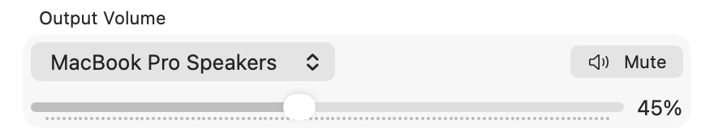</a>
  <a href="docs/images/microphone.png">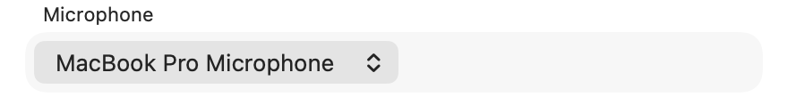</a>
</p>

The **Output Volume** section beneath Screen Layout names the Mac's default output in a picker; choosing another device switches the Mac's default output right away, like Sound › Output. The slider and **Mute / Unmute** appear when the device supports them. Some outputs, commonly HDMI, do not expose software volume; use their physical controls or **Monitor Volume** when the monitor supports DDC/CI. Output Volume is a live system control and is **not saved in profiles**. See [Output Volume](docs/user-guide.md#output-volume).

**Microphone**, directly below, is the same for input: it names the Mac's default input right now and switches it like Sound › Input. It remembers nothing. To make a microphone follow a display, use the **Mic** row under that display's More Controls. When no input device is present the section reads "No microphone detected."

## Identify your screens

Click **Identify Displays** beneath Screen Layout. Large numbers and display names appear for five seconds, matching the preview. Mirrored screens share a group such as **1 + 2**. The labels do not change settings, steal focus or block clicks. See [Identify Displays](docs/user-guide.md#identify-displays).

## Choose and save the main screen

1. Use **Extend** mode and find the desired display’s card. Use **Identify Displays** if needed.
2. Open **Place… → Make [display name] Main**, then **Keep Changes**. The preview marks it **Main**.
3. Save a new profile, or choose **Profile → Overwrite with Current Settings → [profile name]**.

Both **Full setup** and **Layout only** profiles save the main-screen choice.

## Profiles: one name per room

Rooms differ. The same laptop mirrors to a 4K TV in 204, extends to a portrait screen in the library, and needs the laptop full-screen at the podium. Save each as a profile:

<p align="center">
  <a href="docs/images/profiles.png">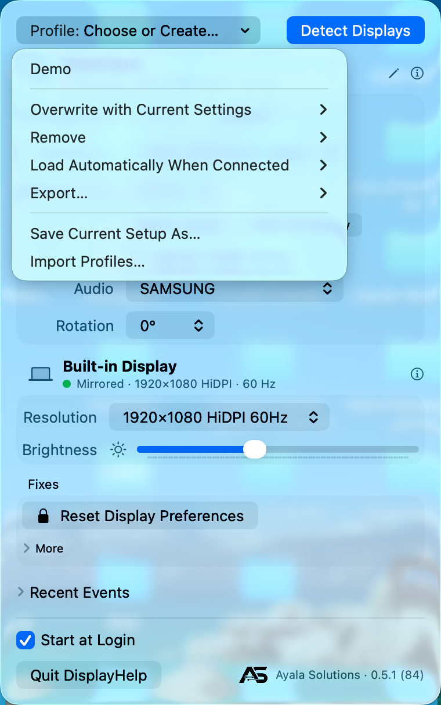</a>
</p>

- Set everything the way you want it on every connected display.
- **Profile › Save Current Setup As…**, type the room, press Save. Choose **Full setup** to include picture controls, audio output and microphone, or **Layout only** for resolution, refresh rate, rotation, position, mirroring and the main display.
- Next time, choose **Profile › Room 204**, review the preview and choose Apply. DisplayHelp restores the available saved settings and checks the result.

<p align="center">
  <a href="docs/images/keep-changes.png">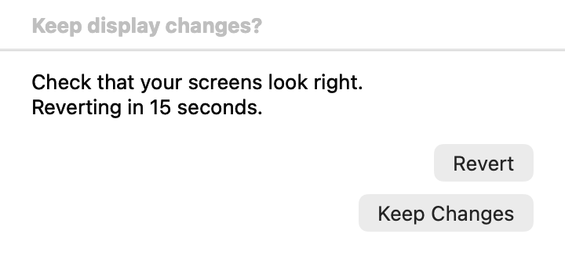</a>
</p>

Manual restores and changes to resolution, rotation, underscan, mirroring, position or the main display open one **Keep Changes / Revert** window. You have 20 seconds to keep the change; otherwise DisplayHelp restores the previous setup. Display changes are verified before they are remembered.

**Quick Switch Profiles** holds two favorite slots, **Favorite 1 (⌘⌥1)** and **Favorite 2 (⌘⌥2)**, that open a profile preview from any app while DisplayHelp is running. **Restore Previous Setup** goes back to the setup from before the last profile switch; **Save Current Setup as Default…** and **Restore Default Setup** keep a permanent starting point.

**Load Automatically When Connected** opts a profile into loading when its exact display set connects or at launch; **Turn Off All Automatic Profiles** makes every profile manual. **Export…** and **Import Profiles…** move setups between Macs, with display, audio output and microphone mapping on import. Imported profiles start with automatic loading disabled.

Profiles also carry each external display's **Signal Cap** level and whether the **EDID Cap** was active; so do Restore Previous Setup and Restore Default Setup. Loading one sets the cap before the modes (or clears it, if the profile was saved with Off, which also turns the EDID Cap off) and turns the EDID Cap on or off as part of the restore (under Keep/Revert when you load it by hand); the preview lists both when they differ, for example `Signal Cap: Off → 1080p` and `EDID Cap: Off → On`. The EDID part only runs where it is supported and the display has a Signal Cap, never on the first automatic load of an imported profile, and a refusal is noted in Recent Events instead of undoing the rest of the profile. Profiles saved before this feature leave both alone.

**How to put the cap in a room profile**

1. Set the Signal Cap, and the EDID Cap if the room needs it, on the projector and keep the changes.
2. Choose **Profile › Save Current Setup As…**, or **Overwrite with Current Settings › ‹room›** for an existing profile.
3. Next time, choose the room, check the Signal Cap and EDID Cap lines in the preview, choose **Apply**, then **Keep Changes**.

Older profiles still load; re-save them to capture settings that older versions did not store. Identical monitors can be saved when macOS provides distinct display UUIDs; those profiles require manual preview.

Everything about profiles, favorites, previews, previous/default setup, identical monitors and import mapping: [user guide › Profile row](docs/user-guide.md#profile-row).

## When something still looks off

| You see | Do this |
|---|---|
| Dock half cut off after plugging in | Wait about three seconds. The app restarts the Dock itself. Else press Detect Displays. |
| Snow or "no signal" on a TV after picking a size | Try a supported size such as 1920×1080. Check the cable, adapter and display input if the problem continues. |
| Everything tiny on the TV | Try Best for Display or choose a readable HiDPI size when available. |
| Black band top and bottom of the laptop while mirrored | Normal for a 16:10 laptop on a 16:9 screen. Turn on Laptop Leads Mirror or use Extend. |
| Black screen or flashing on a long cable or projector | Pick a plain (non-HiDPI) size, then set **Signal Cap** under More Controls. Details above. |
| Display drops and returns every ten seconds | Reseat the cable. Recent Events will show connect/disconnect pairs with no mode change between them. |
| The app asks Mirror/Extend again for a display it knew | The reported display identity may have changed, or saved settings were removed. Choose the arrangement again. |

If the problem continues, open **Troubleshooting → Recent Events** and share the relevant details with your helpdesk, with the display model, cable or adapter, arrangement, resolution and refresh rate. Symptom-by-symptom answers: [troubleshooting](docs/troubleshooting.md).

## Fixes

Expand **Troubleshooting** to reach Detect Displays, fixes, Recent Events and Copy Diagnostics.

- **Reset Display Preferences** 🔒 clears macOS’s saved display configuration and restarts the display session. **Everyone using the Mac is logged out, so save work first.** ColorSync profile files are preserved since 0.5.2.
- **Custom Fixes** are optional actions supplied by your helpdesk as scripts; see below.
- **More › Uninstall DisplayHelp…** 🔒 removes the app, its login agent and package receipt, and optionally your saved profiles and settings.

Details and the IT uninstall command: [user guide › Fixes](docs/user-guide.md#fixes).

### Custom Fixes: install and use your own actions

Custom Fixes are optional troubleshooting actions supplied as separate scripts (DisplayHelp 0.5.1 and later). There is no upload website: install them locally for the user who runs DisplayHelp, in

```text
~/Library/Application Support/DisplayHelp/scripts/
```

1. Extract the supplied “DisplayHelp Custom Fixes” archive; it contains `demo.sh`, `restart-dock.sh` and a README.
2. Copy the script files themselves (not their folder) into the scripts folder, creating it if needed.
3. Close and reopen the DisplayHelp menu. The actions appear under **Custom Fixes**.
4. Run **Demo — Test Custom Fixes** first. A successful test shows `exit 0` and "Demo successful — Custom Fixes is working. No settings were changed."

<p align="center">
  <a href="docs/images/custom-fixes-menu.png">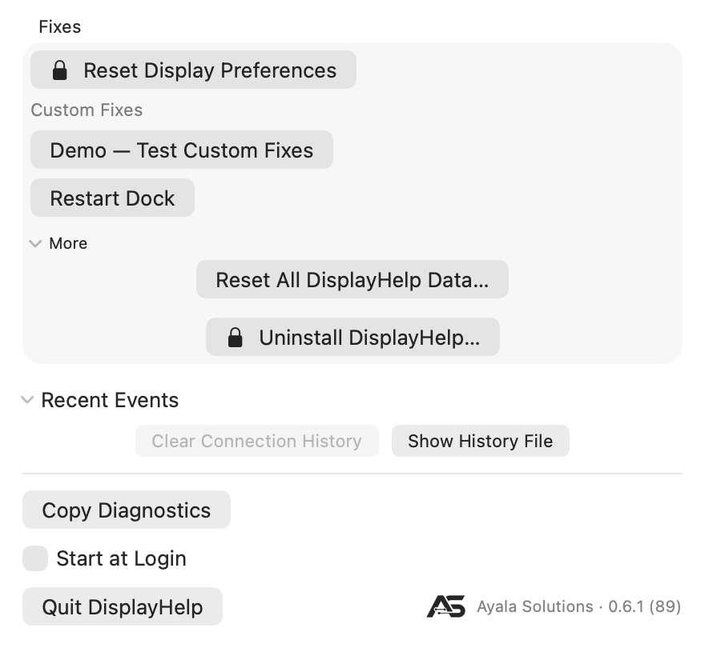</a>
</p>

Scripts must end in `.sh`, belong to the user running DisplayHelp, and not be symbolic links or writable by everyone. Script headers, managed deployment and removal are covered in the [Custom Fixes README](examples/custom-fixes/README.txt) and the [user guide](docs/user-guide.md#custom-fixes).

## Clear history, forget a display, or start fresh

<p align="center">
  <a href="docs/images/data-actions.png">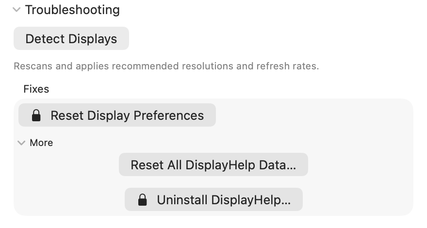</a>
</p>

| What you want | Action | What is kept |
|---|---|---|
| Clear the activity list | **Troubleshooting → Recent Events → Clear Connection History** | Saved profiles, favorites and remembered monitor settings; the old log is archived |
| Ask again when one monitor reconnects (its Signal Cap and EDID Cap go too; the display gets its own EDID back first) | Its **… → Forget This Display…** menu | Saved profiles, favorites, history and the current screen setup |
| Reset all remembered app data | **Troubleshooting → More → Reset All DisplayHelp Data…** | A backup of the old data, custom fixes and the current screen setup |

> [!WARNING]
> The full reset is not secure erasure: the old information remains in the backup folder next to the app's data. See the [complete reset and restore instructions](docs/user-guide.md#clear-history-forget-a-display-or-start-fresh).

## Where it keeps things

DisplayHelp keeps your saved display choices, profiles and recent activity locally in your macOS user account. Different users and different Macs keep separate settings. Use the app’s profile export and import controls to move saved setups.

| Saved information | Contents |
|---|---|
| Display preferences | Names and per-display choices used on this Mac |
| Profiles | Named setups with display, layout and audio settings |
| Recent activity | Connection, setting-change and troubleshooting events |
| Helpdesk fixes | Optional actions supplied by your organization |

**Troubleshooting → Copy Diagnostics** copies the current layout, display capabilities, each display's requested signal, Signal Cap and EDID Cap state, each external display's EDID bytes with the decoded identity and timings (and, while the EDID Cap is in, the display's own EDID beside the one in use with a line on what the trim changed, and the raw reason when a cap was refused), audio output, the last HDCP reading for each external display and up to 20 recent events to your clipboard for support. Monitor identities and event details are included, so review the text before sharing. Unreadable profile files are preserved and recoverable from a last-good backup. File formats: [data files](docs/data-files.md).

## Helpdesk deployment

| Step | What to check |
|---|---|
| Requirements | macOS 14 or later on Apple Silicon or Intel Macs. |
| Install | Deploy the signed and notarized installer with your organization’s Mac management service. |
| Pilot | Test representative rooms, displays, adapters, audio outputs and reconnect behaviour before wider deployment. |
| Profiles | Import a saved setup on each destination Mac, map its devices, preview it and verify the result. |
| Automatic loading | Enable only after the intended exact display set has been tested. Imported profiles start with it disabled. |
| Projectors and long cables | Set a Signal Cap per projector and save it in the room profile; confirm on the projector's input-info menu. Pilot the EDID Cap on both platforms before relying on it: on Apple Silicon it uses a private macOS interface live under Keep/Revert; on Intel it is an override file written by DisplayHelp Updater after the self-service approval, taking effect after reconnect or restart. |
| Support | Use Recent Events and the actual connection details when investigating a problem. |
| Removal | Use the app’s Uninstall command. Choose whether saved profiles and settings should also be removed. |

Build, sign, notarize, pilot and fleet-push steps: [rollout](docs/rollout.md).

## Example custom scripts

These optional files are distributed separately from the app. They run locally; nothing is uploaded. The demo is the recommended first test.

- [Demo — Test Custom Fixes](examples/custom-fixes/demo.sh): confirms that a custom fix can run. Changes no settings, restarts nothing and needs no administrator password.
- [Restart Dock](examples/custom-fixes/restart-dock.sh): briefly restarts the Dock. It does not reset display preferences or delete color profiles.

### Install from Downloads

Extract the Custom Fixes archive into Downloads, then run these commands as the signed-in user, without sudo. Back up any custom script with the same filename before replacing it.

```zsh
mkdir -p "$HOME/Library/Application Support/DisplayHelp/scripts"
install -m 755 "$HOME/Downloads/DisplayHelp Custom Fixes/demo.sh" "$HOME/Library/Application Support/DisplayHelp/scripts/demo.sh"
install -m 755 "$HOME/Downloads/DisplayHelp Custom Fixes/restart-dock.sh" "$HOME/Library/Application Support/DisplayHelp/scripts/restart-dock.sh"
```

The third command is optional. Reopen the DisplayHelp menu and run the demo to verify installation. See the [complete Custom Fixes instructions](examples/custom-fixes/README.txt) for script headers and managed deployment.

## Privacy

DisplayHelp makes no network connections except **Check for Update…**, which contacts GitHub only when you click it. It reads display identity and keeps settings and activity locally, with diagnostics also available through macOS. Export writes profiles to a location you choose; they include display and audio identifiers, so share them only with the intended recipients. Administrator authentication for Reset and Uninstall is handled by macOS.

## Resources

| Where | What you get |
|---|---|
| [User guide](docs/user-guide.md) | Every control, step by step, with screenshots |
| [FAQ](docs/faq.md) | Short answers to the common questions |
| [Troubleshooting](docs/troubleshooting.md) | Symptom by symptom |
| [Rollout](docs/rollout.md) | Build, sign, notarize, pilot and fleet-push steps for IT |
| [Documentation index](docs/README.md) | Everything else, including data files and screenshots |
| [Release history](CHANGELOG.md) | What changed in each version |


### Watch the guide

<p align="center"> <a href="https://youtu.be/JUq-EWzM_t8"> 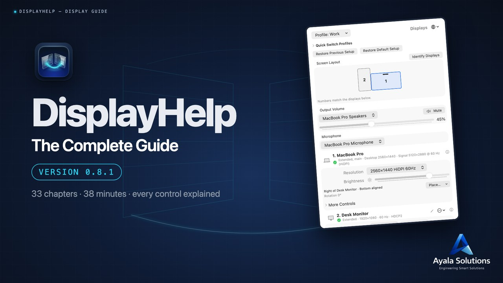 </a> </p>

[DisplayHelp 0.8.1 — The Complete Guide](https://youtu.be/JUq-EWzM_t8) walks every control in 38 minutes, with chapters for install, the menu bar icon, Mirror and Extend, Keep or Revert, Signal Cap and the EDID Cap, Check HDCP, microphones, profiles, fixes, languages and self-service updates.

---

DisplayHelp is made by Ayala Solutions. Engineering Smart Solutions.
